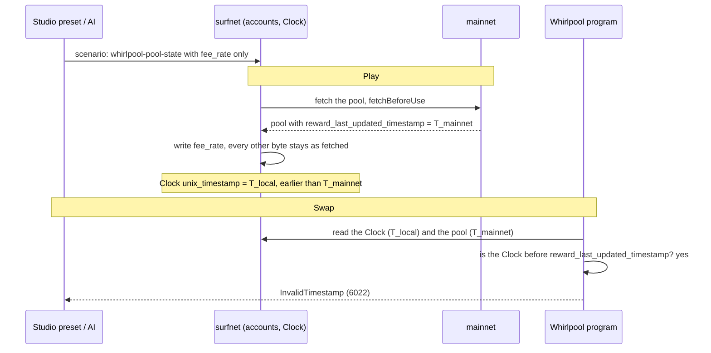
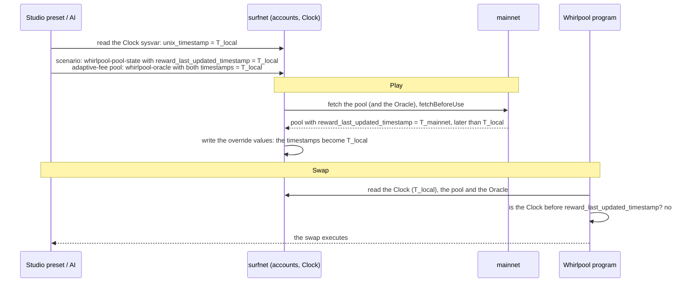

# Whirlpool

Orca's concentrated-liquidity AMM. Three templates: one for any pool, one for an adaptive-fee pool's
Oracle, one for the protocol's fee config. For how scenarios work in general see the
[scenarios README](../../README.md).

# Template index

**Whirlpool** &middot; `whirLbMiicVdio4qvUfM5KAg6Ct8VwpYzGff3uctyCc`

| Template | Overrides |
|---|---|
| `whirlpool-pool-state` | a pool's price, active liquidity, fees and last reward update |
| `whirlpool-oracle` | the timestamps on an adaptive-fee pool's Oracle |
| `whirlpools-config` | the protocol fee new pools are created with |

## Number formats

| You'll see | It means | Example |
|---|---|---|
| `sqrt_price` | `sqrt(price_raw) x 2^64`, as a decimal **string** | `"7144393258922745856"` = 150 USDC per SOL |
| `liquidity` | raw `u128`, as a decimal **string** | |
| `fee_rate` | hundredths of a basis point, max `60000` | `3000` = 0.30%, `10000` = 1% |
| `protocol_fee_rate` | basis points of the fee, not of the swap, max `2500` | `1300` = 13% of the fee |

`price_raw` is token B per token A in raw units. For SOL/USDC (9 and 6 decimals) the human price is
`price_raw x 10^3`.

## Picking a pool

There is no catalog. Pass the pool address, or name a pair: the template's `llm_context` tells the
model to search the program by the two mints and take the pool whose token A vault holds the
most. For SOL/USDC that is `Czfq3xZZDmsdGdUyrNLtRhGc47cXcZtLG4crryfu44zE` (tick spacing 4). Orca also
lists pools at `https://api.orca.so/v2/solana/pools`.

Set `fetchBeforeUse: true` so the pool is pulled from upstream first.

## The local clock

The surfnet Clock trails upstream and Play pauses it, so a pool pulled from upstream usually has a
`reward_last_updated_timestamp` ahead of it, and Whirlpool refuses swaps with `InvalidTimestamp`
(6022). On every pool a swap will touch, set that field to the Clock's `unix_timestamp` (seconds,
from `SysvarC1ock11111111111111111111111111111111`). An adaptive-fee pool, one whose `tick_spacing`
differs from its `fee_tier_index_seed`, also checks two timestamps on its Oracle, the PDA
`["oracle", pool]`; set both with `whirlpool-oracle`:

```
template: whirlpool-pool-state
reward_last_updated_timestamp: <Clock unix_timestamp>

template: whirlpool-oracle        # adaptive-fee pools only
whirlpool: <pool>
adaptive_fee_variables.last_reference_update_timestamp: <Clock unix_timestamp>
adaptive_fee_variables.last_major_swap_timestamp:       <Clock unix_timestamp>
```

The Studio price shock and fee rate presets write these for you.

In order, who touches which account and field. Without the timestamp in the override:



With it:



# Recipes

## Shock the price

Use **Scenario presets → Whirlpool state → Price shock** in Studio. It reads the pool and the tick
arrays the move crosses, and writes all three coupled fields:

```
template: whirlpool-pool-state
sqrt_price:         "<round(sqrt_price x sqrt(factor))>"
tick_current_index: <floor(2 x log(new_sqrt_price / 2^64) / log(1.0001))>
liquidity:          "<live liquidity +/- liquidity_net of every initialized tick crossed>"
```

The shock reads the pool when the scenario is created and stores these as absolute values, so if the
pool's liquidity changes before Play, create the scenario again.

**Never move the price without `liquidity`.** The pool keeps the old range's depth at the new
price, and swaps succeed with wrong amounts: a +10% move on the SOL/USDC pool with tick spacing 64
(`HJPjoWUrhoZzkNfRpHuieeFk9WcZWjwy6PBjZ81ngndJ`) left it about 4.4x too deep. Going up, a tick `t`
is crossed when `old < t <= new` and its `liquidity_net` is added; going down, when
`new < t <= old` and it is subtracted.

**The destination tick array must exist.** A swap resumes from the array covering the new tick,
PDA `["tick_array", pool, start_index.to_string()]` with 88 ticks of `tick_spacing` each. Studio
refuses a move onto a missing array and names the largest (or smallest) factor that stays on the
pool's current one.

## Make swaps expensive

```
template: whirlpool-pool-state
fee_rate: 10000      # 1%
```

## Change the default protocol fee

```
template: whirlpools-config
default_protocol_fee_rate: 2500     # 25%, the program maximum
```

Only pools created after the override copy it. For an existing pool set `protocol_fee_rate` on
`whirlpool-pool-state`.

# Troubleshooting

| Symptom | Fix |
|---|---|
| `InvalidTimestamp` (6022) on every swap | The surfnet Clock is behind the pool's `reward_last_updated_timestamp` or, on an adaptive-fee pool, its Oracle's timestamps. Set them to the Clock's `unix_timestamp` with `whirlpool-pool-state` and `whirlpool-oracle`, as in [The local clock](#the-local-clock) |
| The swap succeeds but the amounts look wrong after a price change | `liquidity` was not moved with the price. Use the Studio price shock |
| The swap fails right after a price change | The new tick has no tick array, or `sqrt_price` and `tick_current_index` disagree |
| The swap fails on the token transfer | The paying vault (`token_vault_a` / `token_vault_b`) holds less than the output. Fund it with `spl-token-account-balance` |
